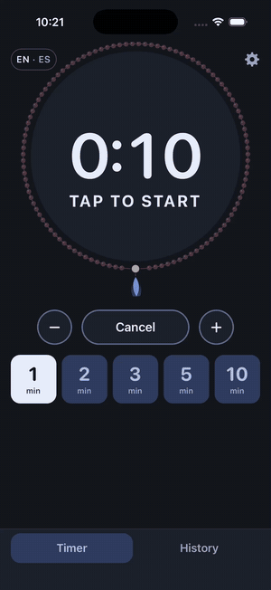

<div align="center">


# Yogi Timer

**A calm, one-tap countdown timer for teaching yoga.**
It keeps a history of your lessons and works offline from your iPhone's Home Screen.

[**Open Yogi Timer →**](https://bosquedepalma.github.io/yogi/)

<br>



</div>

## Features

- **Two taps to start.** Pick 1, 2, 3, 5 or 10 minutes, then tap the lotus. Adjust the time with − and + first if you need to.
- **Readable across the room.** A large countdown inside a mala of 108 beads that light up while a lotus blooms.
- **Pause with a tap** on the lotus. Stop only shows while paused, so a stray tap mid-class never ends a Run.
- **A chime at zero:** singing bowl, tingsha or gong. It plays even with the silent switch on.
- **Lessons record themselves.** Runs close together form one lesson, and History keeps every lesson on your phone.
- **English and Spanish**, with the EN · ES switch in the corner.
- **Light and dark**, in two themes, Glow and Bead, or **Auto**, which changes with the time of day.
- **Works offline** once added to the Home Screen. Nothing leaves your phone.

## Install on iPhone

1. Open **[bosquedepalma.github.io/yogi](https://bosquedepalma.github.io/yogi/)** in Safari.
2. Tap **Install** on the banner and follow the steps: **Share → Add to Home Screen**, with **Open as Web App** on.
3. Open Yogi Timer from your Home Screen once while online. From then on it works offline.

## Development

Built with [Vite](https://vite.dev), [Stimulus](https://stimulus.hotwired.dev), plain JavaScript and modern CSS, with no backend.

```bash
npm install
npm run dev      # dev server at http://localhost:5173
npm test         # Vitest
npm run build    # static site in dist/
```

Every push to `main` publishes to GitHub Pages.

The domain language is in [GLOSSARY.md](GLOSSARY.md), and the architecture decision is in [docs/adr](docs/adr/0001-static-home-screen-web-app.md).
